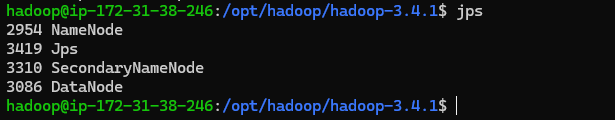
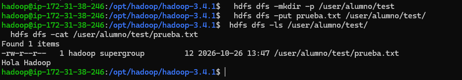
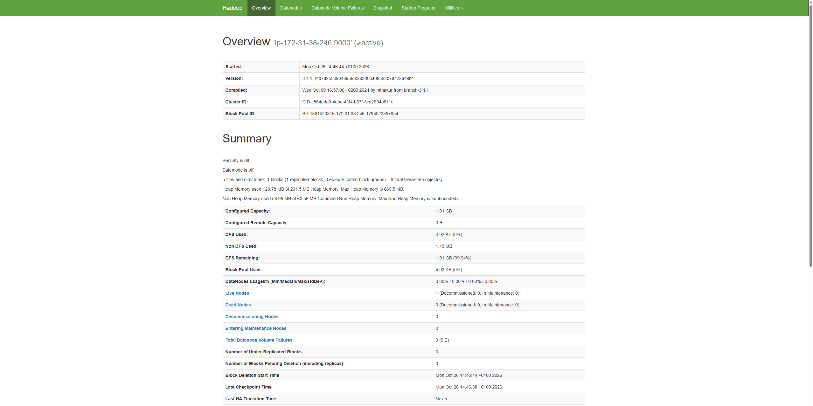
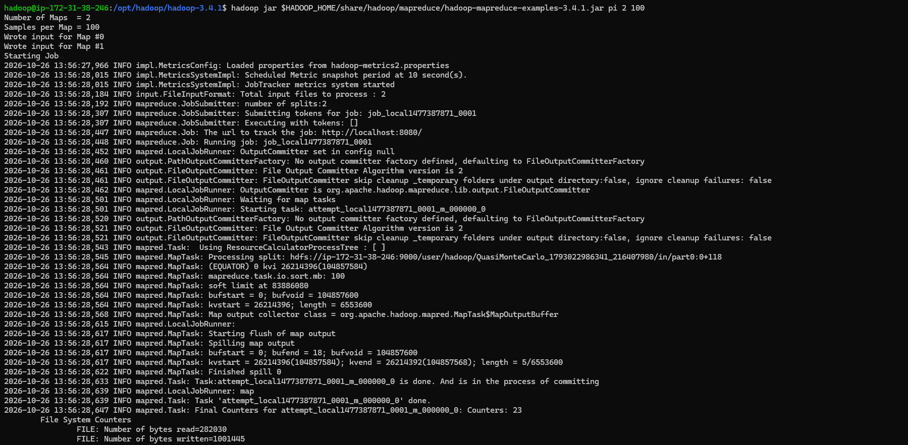
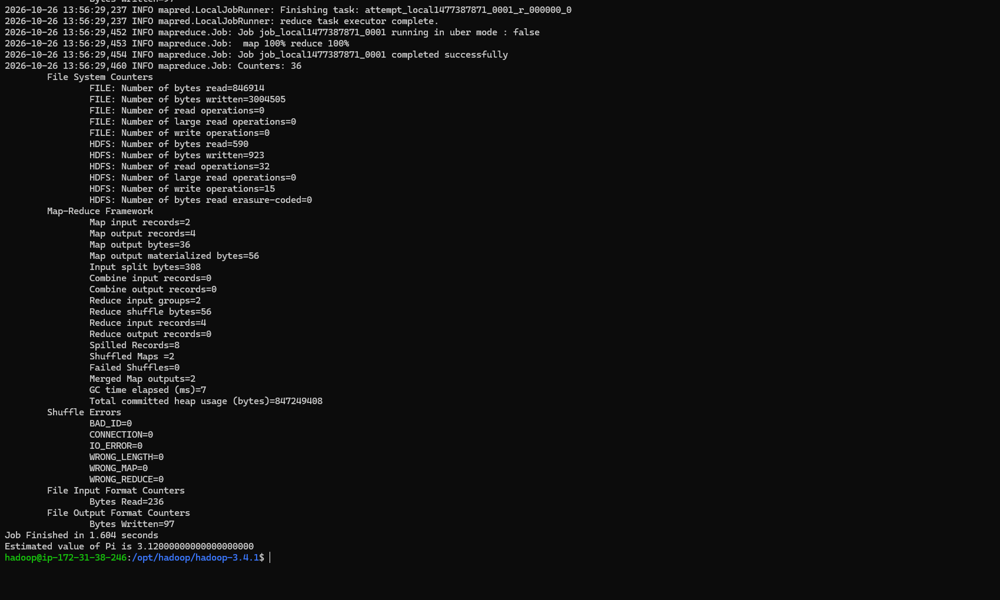

# PR0201 · Instalación de Hadoop en modo pseudo-distribuido

**Unidad:** UT02 · Almacenamiento distribuido e integridad con HDFS  
**Resultado de aprendizaje:** RA3  


## Objetivo

Demostrar la instalación, configuración y puesta en marcha de Apache Hadoop en modo pseudo-distribuido sobre una instancia remota de AWS EC2. La entrega debe acreditar tanto la autoría del entorno como el funcionamiento de los servicios Hadoop, HDFS y MapReduce.

## Evidencias

Incluye las siguientes capturas en el documento. En las capturas de terminal, deja visible y legible el prompt con el usuario y el nombre de la máquina o la IP de la instancia remota. No sustituyas las capturas por una transcripción de la salida.

### 1. Conexión SSH y servicios Hadoop

Conéctate por SSH a la instancia EC2 y ejecuta:

```bash
jps
```
**Captura 1:** sesión SSH y salida completa de `jps`. Deben aparecer los procesos `NameNode`, `DataNode`, `SecondaryNameNode`, `ResourceManager` y `NodeManager`.




### 2. Operaciones básicas en HDFS

Desde la instancia, crea un fichero de texto local con contenido propio. Por ejemplo:

```bash
printf 'Texto de prueba escrito por <nombre del alumno>\n' > prueba.txt
```

Ejecuta el ciclo de operaciones sobre HDFS:

```bash
hdfs dfs -mkdir -p /user/alumno/test
hdfs dfs -put prueba.txt /user/alumno/test/
hdfs dfs -ls /user/alumno/test/
hdfs dfs -cat /user/alumno/test/prueba.txt
```

**Captura 2:** comandos y salidas del ciclo completo. Debe verse el fichero en el listado y el contenido personalizado que se ha almacenado.



### 3. Interfaz web del NameNode

Abre en un navegador la consola web de HDFS:

```text
http://<IP_PUBLICA_EC2>:9870
```

También puedes acceder mediante un túnel SSH. En la pestaña **Overview**, comprueba que aparece `Live Nodes = 1` y que se muestra la capacidad disponible en HDFS.

**Captura 3:** pestaña **Overview** con el estado del clúster y la capacidad, legibles.




### 4. Ejecución de MapReduce

Ejecuta el ejemplo de cálculo de π incluido con Hadoop:

```bash
jar $HADOOP_HOME/share/hadoop/mapreduce/hadoop-mapreduce-examples-3.4.1.jar pi 2 100
```

**Captura 4:** salida completa de la ejecución, incluyendo el lanzamiento del trabajo, el progreso de las tareas map/reduce y el resultado final `Estimated value of Pi is…`.





## Comprobación de la entrega

- [ ] Las cuatro evidencias son legibles y corresponden al entorno remoto utilizado.
- [ ] Las capturas de terminal muestran el prompt de la instancia.
- [ ] La salida de `jps` muestra los cinco procesos requeridos.
- [ ] HDFS lista el fichero y muestra el contenido personalizado.
- [ ] La consola web muestra un nodo activo y la capacidad de HDFS.
- [ ] MapReduce termina y muestra la estimación de π.

[Volver a UT02](../index.md)
