# PR0202 · Uso del cliente HDFS

**Unidad:** UT02 · Almacenamiento distribuido e integridad con HDFS  
**Resultado de aprendizaje:** RA3  


## 1. Preparación del entorno

**Enunciado:** Crea tu directorio personal en `/user`, con tu nombre de usuario, y dentro de él el directorio `proyecto_datos`.

**Comando utilizado:**

```bash
hdfs dfs -mkdir -p /user/hadoop/proyecto_datos
hdfs dfs -ls /user/hadoop
```

**Salida / primeras líneas:**

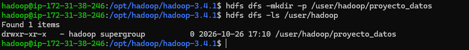
## 2. Carga del dataset

**Enunciado:** Descarga desde [Kaggle](https://www.kaggle.com/datasets/metawave/vehicle-price-prediction) el *Automotive Price Prediction Dataset*. Sube el archivo CSV descargado desde el sistema local a tu directorio `proyecto_datos`.

**Archivo utilizado:** `vehicle_price_prediction.csv`

**Ruta local del archivo:** `$HOME\Downloads\vehicle_price_prediction.csv`

**Comandos utilizados:**

```bash
scp -i "hadoop.pem" "$HOME\Downloads\vehicle_price_prediction.csv" ubuntu@13.220.227.173:~/
```
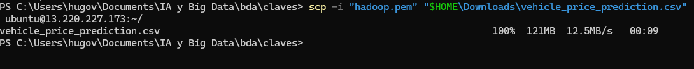
```bash
ls -lh /home/ubuntu/vehicle_price_prediction.csv
sudo cp /home/ubuntu/vehicle_price_prediction.csv /home/hadoop/
sudo chown hadoop:hadoop /home/hadoop/vehicle_price_prediction.csv
```
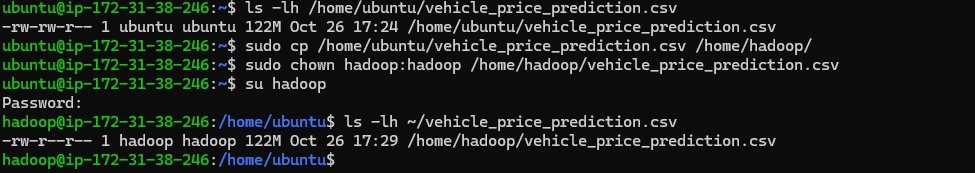
```bash
hdfs dfs -put ~/vehicle_price_prediction.csv /user/hadoop/proyecto_datos/
hdfs dfs -ls /user/hadoop/proyecto_datos
```
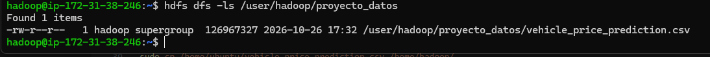


## 3. Exploración del dataset

**Enunciado:** Visualiza el contenido del archivo directamente desde HDFS y averigua cuántas líneas tiene.

**Comando utilizado:**

```bash
hdfs dfs -cat /user/hadoop/proyecto_datos/vehicle_price_prediction.csv | head -n 10
```
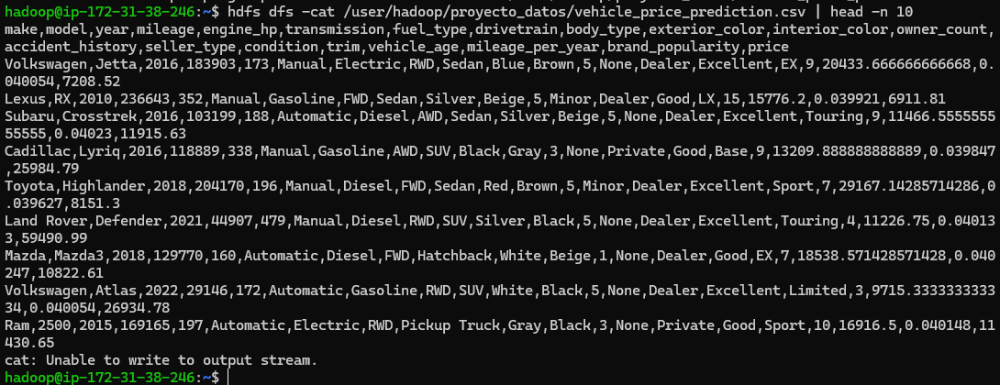
```bash
hdfs dfs -cat /user/hadoop/proyecto_datos/vehicle_price_prediction.csv | wc -l
```
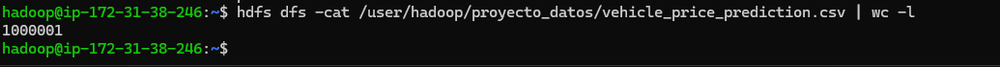


**Número de líneas:** `1000001`

## 4. Organización del proyecto

**Enunciado:** Crea los subdirectorios `procesados` y `backup`. Copia el archivo original en `backup` y mueve el original a `procesados`.

**Comando utilizado:**

```bash
hdfs dfs -mkdir -p /user/hadoop/proyecto_datos/procesados
hdfs dfs -mkdir -p /user/hadoop/proyecto_datos/backup
hdfs dfs -cp /user/hadoop/proyecto_datos/vehicle_price_prediction.csv /user/hadoop/proyecto_datos/backup/
hdfs dfs -mv /user/hadoop/proyecto_datos/vehicle_price_prediction.csv /user/hadoop/proyecto_datos/procesados/
```

**Salida / comprobación:**

```bash
hdfs dfs -ls /user/hadoop/proyecto_datos
hdfs dfs -ls /user/hadoop/proyecto_datos/backup
hdfs dfs -ls /user/hadoop/proyecto_datos/procesados
```

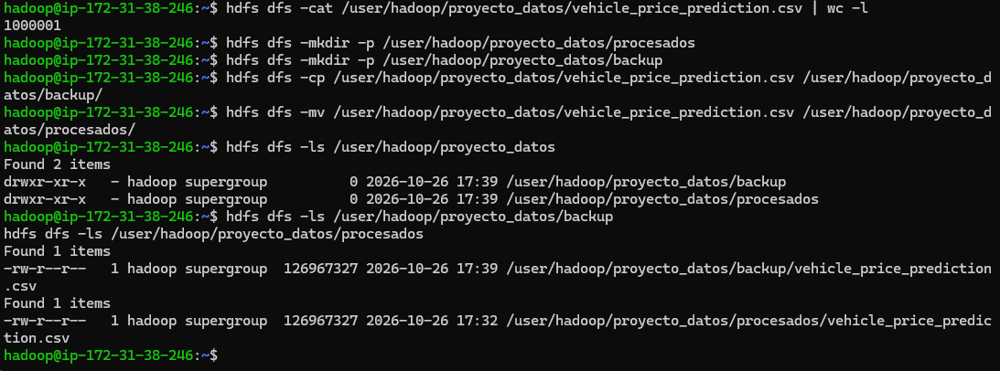

## 5. Colaboración en el equipo

**Enunciado:** Crea el directorio compartido `/compartido` si no existe y copia allí el dataset para que otros usuarios puedan acceder.

**Comando utilizado:**

```bash
hdfs dfs -mkdir -p /compartido
hdfs dfs -cp /user/hadoop/proyecto_datos/procesados/vehicle_price_prediction.csv /compartido/
hdfs dfs -chmod 755 /compartido
hdfs dfs -chmod 644 /compartido/vehicle_price_prediction.csv
hdfs dfs -ls /compartido
```

**Salida / primeras líneas:**

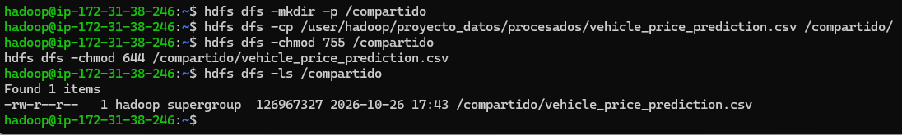

## 6. Recuperación de datos

**Enunciado:** Descarga a tu sistema local el archivo que se encuentra en `procesados`.

**Directorio local de destino:** `<ruta local>`

**Comando utilizado:**

```bash
hdfs dfs -get /user/hadoop/proyecto_datos/procesados/vehicle_price_prediction.csv /home/hadoop/
ls -lh /home/hadoop/vehicle_price_prediction.csv
```
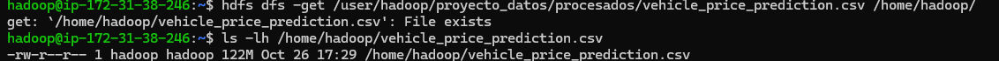
```bash
sudo cp /home/hadoop/vehicle_price_prediction.csv /home/ubuntu/
sudo chown ubuntu:ubuntu /home/ubuntu/vehicle_price_prediction.csv

scp -i ".\hadoop.pem" ubuntu@13.220.227.173:/home/ubuntu/vehicle_price_prediction.csv "$HOME\Downloads\"
Get-Item "$HOME\Downloads\vehicle_price_prediction.csv"
```

**Salida / primeras líneas:**
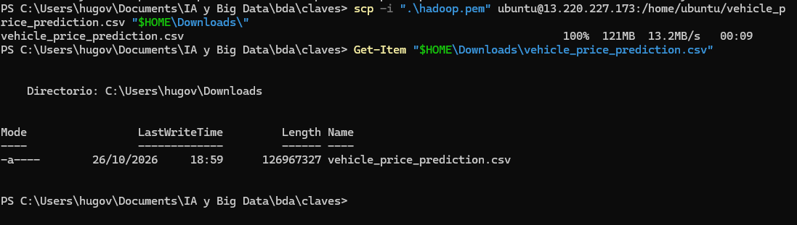

## 7. Control de accesos

**Enunciado:** Comprueba los permisos de los archivos y cambia los permisos del archivo de `backup` para que solo tú tengas acceso de lectura y escritura.

**Comando utilizado:**

```bash
hdfs dfs -ls /user/hadoop/proyecto_datos
hdfs dfs -ls /user/hadoop/proyecto_datos/backup
hdfs dfs -chmod 600 /user/hadoop/proyecto_datos/backup/vehicle_price_prediction.csv
hdfs dfs -ls /user/hadoop/proyecto_datos/backup
```

**Salida / primeras líneas:**
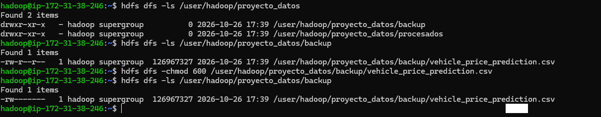

## 8. Mantenimiento

**Enunciado:** Sube a tu espacio HDFS un archivo temporal de prueba y elimínalo.

**Comando utilizado:**

```bash
hdfs dfs -ls /user/hadoop/proyecto_datos
echo "Archivo temporal de prueba" > temporal.txt
hdfs dfs -put temporal.txt /user/hadoop/proyecto_datos/
hdfs dfs -rm /user/hadoop/proyecto_datos/temporal.txt
hdfs dfs -ls /user/hadoop/proyecto_datos
```

**Salida / primeras líneas:**

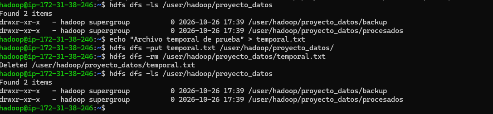

[Volver a UT02](../index.md)
